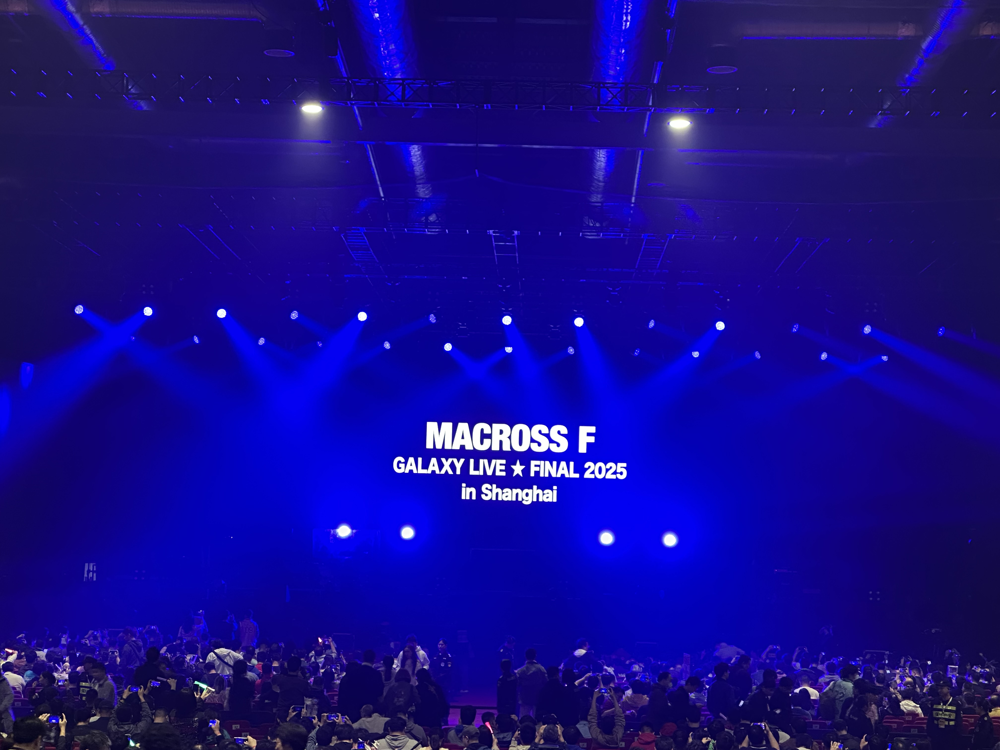
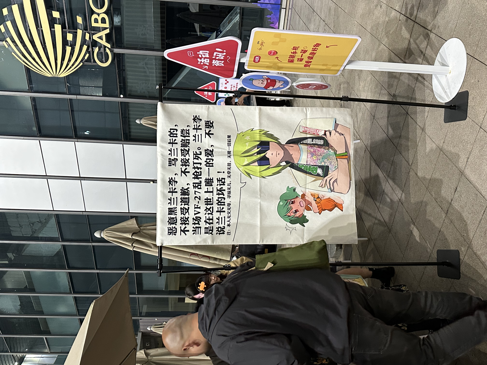
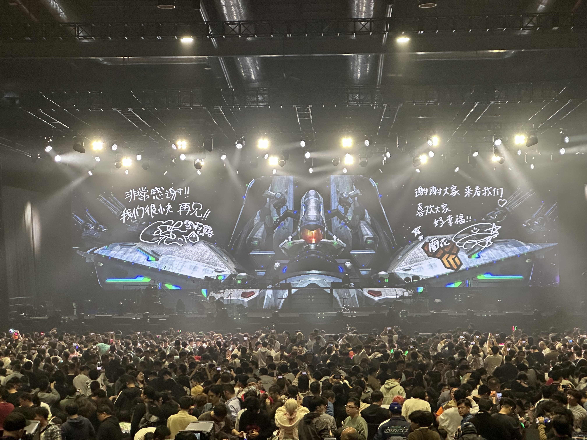
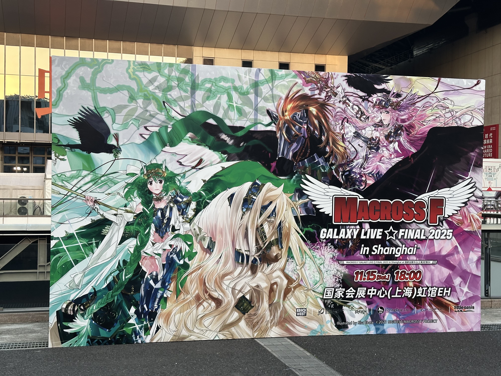
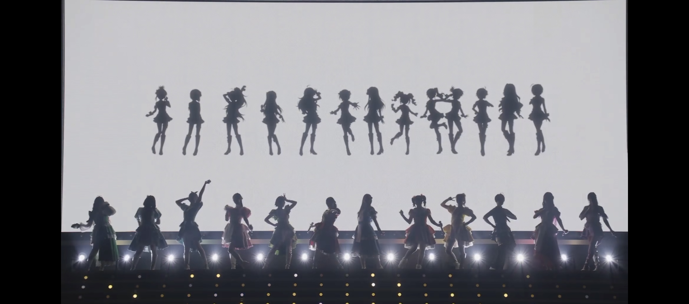
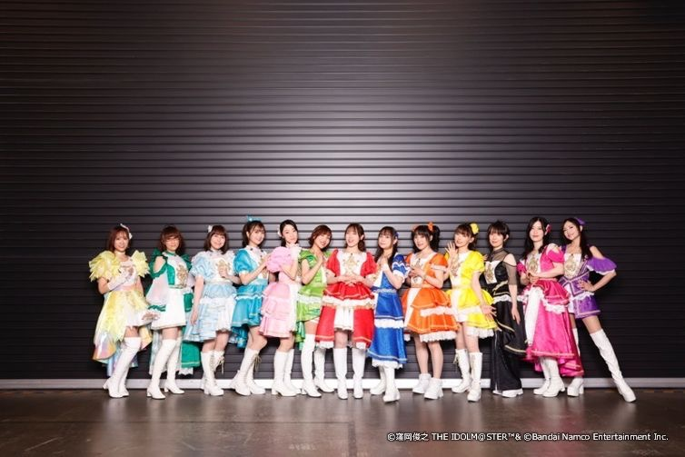
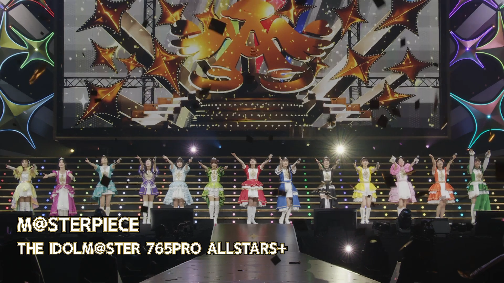
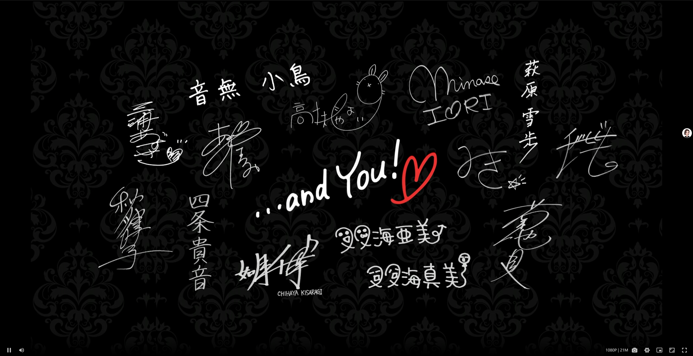
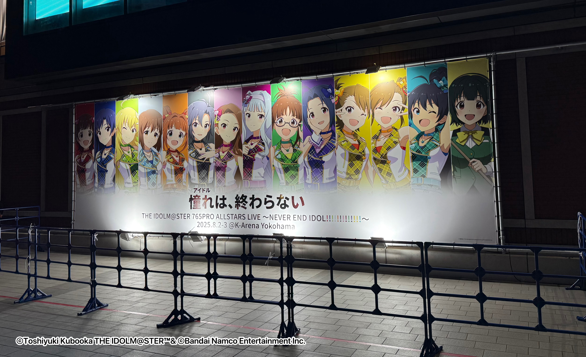
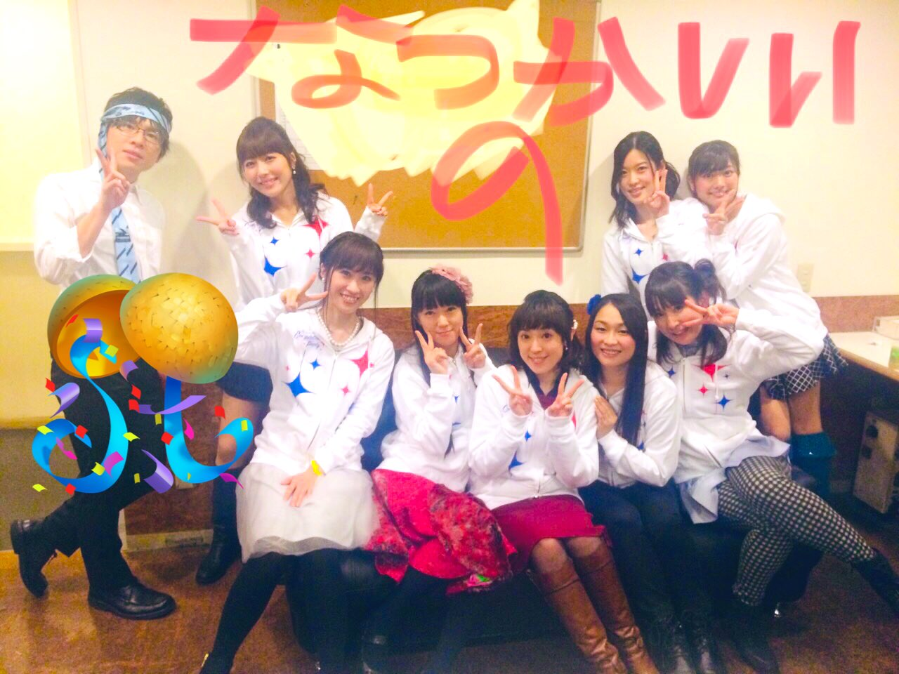

# 短评集

> 本篇主要包含一些难以成文的短评

<!-- brief-comments:start -->

<!-- brief-comments-year:start -->
<!-- brief-comments-summary:2025 -->

<!-- brief-comments-comments:start -->
<!-- brief-comments-logo:./_media/logo.jpg -->
<!-- brief-comments-comments-container:start -->

真的是久违地，参加了一次 live。上一次已经在疫情前了。安可的前两首曲子都是菅野洋子钢琴伴奏，May'n 和中岛爱演唱的无插电版本，可以说是本次 live 最大的惊喜之一了。May'n 几乎可以算半个翻译了，真的是汉语进步了许多。感慨很多但真就像韩愈所说的那样真想说的时候反而却又不知道该说什么好了。说实话感觉好像找回了什么，一定是很珍贵的东西，是在心底的对二次元（如果这个词还真能够指代从前还是小圈子亚文化时它所支撑的那个东西的话）的那份热爱吧。

感觉还是该多看、多跑现地了。

<!-- brief-comments-divider:2025.11.16 -->
<!-- brief-comments-comments-container:end -->
<!-- brief-comments-comments:end -->

<!-- brief-comments-comments:start -->
<!-- brief-comments-logo:./_media/logo.jpg -->
<!-- brief-comments-comments-container:start -->

八月二三日的偶像大师 765pro all stars+ NEVER END IDOL，说实话 24 年刚宣布的时候还下定决心这次一定要去看的，结果售票期间正好在搞科研为了毕业忙忘了，这么一说就愈发后悔读研了。明明初星之后难得又有本家全员，结果这次又错过了，不知道又要等到什么时候才能有下一次。线上看了两天的 live，只能感叹能接触、喜欢上这个企划真是太好了。二十年的企划，我第一次接触到现在也有快十年了。10 年的动画本篇以制作人的假装采访开始，本次 live 的 DAY 2 则以第一天小偶像们给制作人录制的第一份影像结束，影像播放结束后她们则戴上了最初的お姫様ティアラ重新登上舞台，「Destiny」一曲响起就已经说尽了所有。

不是千早 p，明年一月二十四的单独 live 大概不会去现地的。下一次本家全员的 live 又要等到什么时候呢？25 周年？又或是 30 周年？不过至少下一次，大抵是真的一定会去的了。

<!-- brief-comments-divider:2025.08.11 -->
<!-- brief-comments-comments-container:end -->
<!-- brief-comments-comments:end -->

<!-- brief-comments-comments:start -->
<!-- brief-comments-logo:./_media/logo.jpg -->
<!-- brief-comments-comments-container:start -->

重看「The Magicians」。不得不再次感叹第四季结尾拍的实在是太好了。一片灰白的世界中随着 Q 手指的动作，只有零星的光点爬过镜子上的裂痕。通向狭缝的画面重又出现在恢复如初的镜子上时，爬完裂痕的光点迸发成了一束束的火花，吞噬回眸的 Q。但不仅仅是升格镜头下奏着“Cruel World”的无声的片段，写的更好的恰恰在于随后 Q 在冥界中对从前伙伴的自我剖析。但无论他到底是拯救了朋友，又或者他真只是终于找到了自杀的方式，当伙伴们在夜幕中围绕着火堆，用“Take on Me”唱出无法说出的情愫，一件件地丢出那些记录着苦痛现实生活中的和 Q 共度的零星欢乐时光的物件，原因究竟如何已经无关紧要了。串联起整个四季度的不仅仅是一直未能发现的 Q 的小物修复这种不能更朴素的特长，不仅仅是 Q 从最初就已经有的抑郁症倾向，还是早在最初就已经指出的理论：Magic comes from pain。痛苦之中 J 抛出扑克时做出了和 Q 第一次相同的魔法，于此终于一切全都串联起来了。最后的最后让 Q 走过放下的门，更是再直白不过地直指四季度真正的内核。魔法外衣带来的幻想固然最能吸引人，但本作的最大亮点，也是足以让本作成为极优秀的作品的点恰恰在于从最初的最初就已铺设的，抛离魔法之后从最初的最初就已经一直铺设的对现实的无力感的直接抛出。

<!-- brief-comments-divider:2025.01.02 -->
<!-- brief-comments-comments-container:end -->
<!-- brief-comments-comments:end -->

<!-- brief-comments-year:end -->

<!-- brief-comments-year:start -->
<!-- brief-comments-summary:2024 -->

<!-- brief-comments-comments:start -->
<!-- brief-comments-logo:./_media/logo.jpg -->
<!-- brief-comments-comments-container:start -->

看了看大帅官网，发现大帅几个图标都是纯用 svg 的 html 格式写成的，扒下来暂放在这里。另外还发现有[偶像检索](https://idollist.idolmaster-official.jp)这种好网站。

<!-- svg:imas.765 --> <!-- svg:imas.cg --> <!-- svg:imas.ml --> <!-- svg:imas.man --> <!-- svg:imas.ss --> <!-- svg:imas.school -->

<!-- brief-comments-divider:2024.12.03 -->
<!-- brief-comments-comments-container:end -->
<!-- brief-comments-comments:end -->

<!-- brief-comments-comments:start -->
<!-- brief-comments-logo:./_media/logo.jpg -->
<!-- brief-comments-comments-container:start -->

小魔女 doremi 25 周年新的特别映像，音乐选自四期最终话 ED 曲。比起上次更加聚焦于长大了的どれみ，别有味道。

<!-- iframe-video-link:https://www.youtube.com/embed/4AMf-7R7B0k?si=jbtwVbIocQbh5ZXX -->

<!-- brief-comments-divider:2024.07.31 -->
<!-- brief-comments-comments-container:end -->
<!-- brief-comments-comments:end -->

<!-- brief-comments-comments:start -->
<!-- brief-comments-logo:./_media/logo.jpg -->
<!-- brief-comments-comments-container:start -->

爱马仕 20th 活动。

先是之前就有宣传的 SP Live。

新曲。

新服装。

最惊喜的果然还是本家的新 Live 吧！！

20 周年历程速览（高达ww）。

<!-- brief-comments-divider:2024.07.27 -->
<!-- brief-comments-comments-container:end -->
<!-- brief-comments-comments:end -->

<!-- brief-comments-comments:start -->
<!-- brief-comments-logo:./_media/logo.jpg -->
<!-- brief-comments-comments-container:start -->

「你的名字」重映。应该说有太多新的感受了。八年前首映时从来没有体会到的，但如今却能从中感受到太多的乡愁味。直接题为“鄉愁”的展览牵起瀧对みつは的在意，然而这份ノスタルジア还来自于更多的东西。瀧以みつは的身体体会糸守町，而当他终于踏上这片土地时才发现土地早已在三年前就已经不复存在了。这份由超越时间的身体交换所带来的回不去的土地又怎么不是一份乡愁呢？同样的，当みつは第一次从东京的车站进入到无机物的丛林之中，巨大的声音浪潮将她一瞬间淹没了。更不用说みつは的同学们三言两语之中带出的对土地的情感了。“君名”前后日本动画上的巨大差异，对 311 的回忆，冲浦黄濑安藤田中的突出作画，等等这些都已经被一再的述说了。当我重新在八年后再次观看时，影片自身内流动了八年的时间，早就已经和我本身对八年的记忆混在了一起，就好像是柏格森式的绵延的时间那样。

有趣的，之前也从来没有注意到新海诚一贯延续的他本人的趣味，即对女性的脚的捕捉在本片中竟然突出到了如此的程度。从脚开始的对みつは的镜头甚至是作为全片开始而呈现出的镜头，大量的、对脚的镜头，而对みつは亲身前往东京的那一幕甚至全藉低机位的设计去对脚进行捕捉，制服皮鞋的棕色也在其中成为了最吸引观众目光的色彩。更甚者，他甚至还要去对みつは挠脚作出叙事上的交代。某些意味上，倒也契合了如今国内的这股动画圈子内的潮流了。

<!-- brief-comments-divider:2024.07.21 -->
<!-- brief-comments-comments-container:end -->
<!-- brief-comments-comments:end -->

<!-- brief-comments-comments:start -->
<!-- brief-comments-logo:./_media/logo.jpg -->
<!-- brief-comments-comments-container:start -->

开服近三周每天醒来第一件事和睡前最后一件事都是学马仕启动。不得不说虽然人设初见很普但架不住文本塑造写得好，另一方面游戏性也还算不错。名片制作界面感觉也相当不错，可以直接拿来当制作人名片了。

<!-- brief-comments-divider:2024.06.03 -->
<!-- brief-comments-comments-container:end -->
<!-- brief-comments-comments:end -->

<!-- brief-comments-comments:start -->
<!-- brief-comments-logo:./_media/logo.jpg -->
<!-- brief-comments-comments-container:start -->

小魔女 doremi 25 周年特别映像。比起前两年那个做作的「寻找见习魔女」还是这种看到成长后的 doremi 他们的方式更令人感动。虽然似乎要有新作，不过我想小说中那成长后的他们的故事大抵也不会再变成动画了。这几年这种成长为大人后的大家的动画片也未免太多了。作为已经成长为可悲大人的我而言，看到成长后的大家真是有种说不出的滋味。

<!-- iframe-video-link:https://www.youtube.com/embed/i3mzMFy3dBg?si=FLPAmelZry08wb65 -->

音符，好喜欢。

<!-- brief-comments-divider:2024.04.15 -->
<!-- brief-comments-comments-container:end -->
<!-- brief-comments-comments:end -->

<!-- brief-comments-year:end -->

<!-- brief-comments-year:start -->
<!-- brief-comments-summary:2023 -->

<!-- brief-comments-comments:start -->
<!-- brief-comments-logo:./_media/logo.jpg -->
<!-- brief-comments-comments-container:start -->

9 号和 10 号的偶像大师 & Love Live 异次元歌合战，虽然没有去现场不过也是两天全程看了生放配信，这里简单写一下 repo 吧。两天每天八九十个人五十首歌，拉拉这边水虹星莲都是两天全上，爱马仕因为人太多百万灰灰 sc 两天没重样的，比较惊喜的应该是第二天 U149 也来了。Live 本身每天都有混唱部分，包括每个团自己的自选曲目或者虹是 solo 串，到最后则是两个团唱其他团代表曲以及整个系列唱另一个系列的本家曲，例如说 Day1 末拉拉唱了「Ready！」，这个环节确实还不错。两天下来最印象深刻的果然还是 Day2 的两首压轴曲吧，首先是爱马仕热唱「Snow Halation」，时隔多年的名曲以这种形式与大家再见，看到东蛋全场变色那一刻真的是太感动。紧接着的是拉拉热唱「M@sterpiece」，这首对爱马仕 P 而言也是有着相当的份量，而在最后的高潮安排让爱马仕的人加入拉拉变为全体大合唱，更给这周本就意义非常的曲子带来了新的闪耀。当然遗憾的是两方的本家都没来吧。过去那周也正好情绪来了重新看了 765as 的七周年、十周年和 22 年 sunrich colorful 的 live，还有 wug 的 final，感动常在呀。

<!-- brief-comments-divider:2023.12.11 -->
<!-- brief-comments-comments-container:end -->
<!-- brief-comments-comments:end -->

<!-- brief-comments-comments:start -->
<!-- brief-comments-logo:./_media/logo.jpg -->
<!-- brief-comments-comments-container:start -->

我的百合是工作 #6，算是才意识到这片本质上其实隐含了三重的剧场：陽芽工作场所自身主打的剧场性是其一，陽芽自己实时扮演这角色，这使得她所身处的周遭就成了第二层的剧场，而观众本身直视片中角色则是更为直接的第三层的剧场。很有趣的一点在于工作场所自身的客人从某种意义上其实可以说是观众的投影或是替身。因此当所谓陽芽不再说谎加之在店内不再作扮演角色行为的时候，三重的剧场塌缩为了唯一单纯的剧场，荒谬性也是在此消除的。说实话感觉这个设置只用来作这种程度的百合有点可惜。

我倒是想到了 Z 敢达最终回由夏亚卡缪等人构筑出的特殊剧场，确实是很厉害的处理。

<!-- brief-comments-divider:2023.05.17 -->
<!-- brief-comments-comments-container:end -->
<!-- brief-comments-comments:end -->

<!-- brief-comments-comments:start -->
<!-- brief-comments-logo:./_media/logo.jpg -->
<!-- brief-comments-comments-container:start -->

近期观影：热天午后 Dog Day Afternoon，华尔街 Wall Street。

前者两小时几乎只聚焦于一个小小的银行内部及其外部周遭的一小部份街道，从抢劫团伙的一人离场开始全片就开始朝着荒谬而去。即使抛开亚提卡事件和少数群体议题，其中对阶级本质的直指仍是极尖锐的。当摄像机转向桑尼，即使是在抢劫风波之外的人也开始向漩涡中心涌去。然而与大喊我是明星的送披萨小哥相对比的，则是片尾那悠长的空镜头。身为全片内外将近两小时的桑尼在被逮捕后，才发现整个剧场内没有人还会注视他。全片的讽刺性也于此达到了最高潮。

后者的剧本选定比较迎合主流观众，道格拉斯的演绎确实值得一看。

<!-- brief-comments-divider:2023.05.12 -->
<!-- brief-comments-comments-container:end -->
<!-- brief-comments-comments:end -->

<!-- brief-comments-comments:start -->
<!-- brief-comments-logo:./_media/logo.jpg -->
<!-- brief-comments-comments-container:start -->

本日静冈模型展，说实话今天公布的 MS 只有这款基地限定 TOLRO-800 还挺想买来耍耍的。出自敢达 UC 第一话，巴纳吉的第一架座机，名场面飞身就小美。其实还挺乐于见到这类机子的模型化的，包括之前的德戴啊 Base Jabber 啊 89 式啊 94 式啊，G 防卫者和米加粒子炮之类的武器装备类的就更不用说了。很适合摆场景，而且确实是能丰富模型种类。

> 图源（按序）：twi[@HobbySite](https://twitter.com/HobbySite)，twi[@gundambase_t](https://twitter.com/gundambase_t)，[@hobby_magazine](https://twitter.com/hobby_magazine)

<!-- brief-comments-divider:2023.05.11 -->
<!-- brief-comments-comments-container:end -->
<!-- brief-comments-comments:end -->

<!-- brief-comments-year:end -->

<!-- brief-comments-year:start -->
<!-- brief-comments-summary:2022 -->

<!-- brief-comments-comments:start -->
<!-- brief-comments-logo:./_media/logo.jpg -->
<!-- brief-comments-comments-container:start -->

20 年开播的 DQ 终于在 100 话完结，很难以想象如今还能有如此质朴的超长篇动画播出，而其中更是有着不少的神回。ep30、67、73、96，基本上都是以法师ポップ的成长为最核心，而不去聚焦于身为本篇主角的龙骑士之子ダイ。难得的代表着“勇气的”法师ポップ，比起ダイ更称得上是人类的代表、勇者。每一个传统的充斥着剑与魔法的作品所歌颂的人类的勇气，在他身上展现的淋漓尽致，正如 ep96 标题所呈现的那样：「閃光のように」。

<!-- brief-comments-divider:2022.10.22 -->
<!-- brief-comments-comments-container:end -->
<!-- brief-comments-comments:end -->

<!-- brief-comments-year:end -->

<!-- brief-comments:end -->
